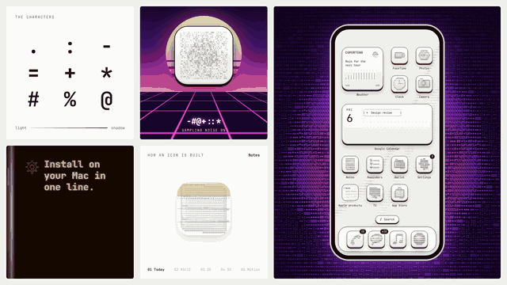
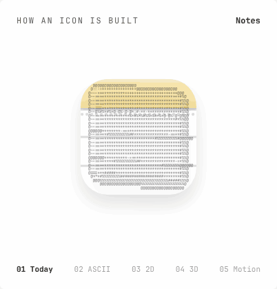
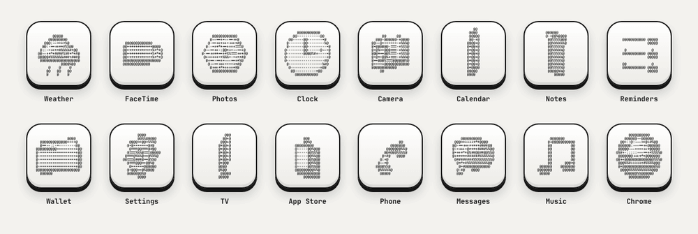
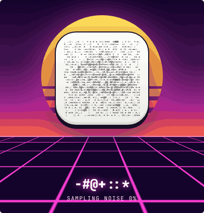
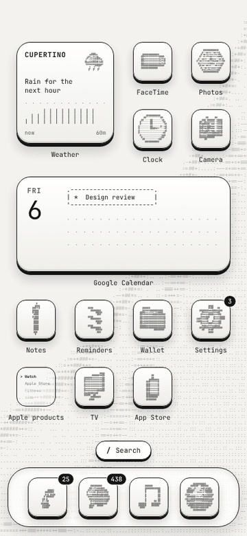
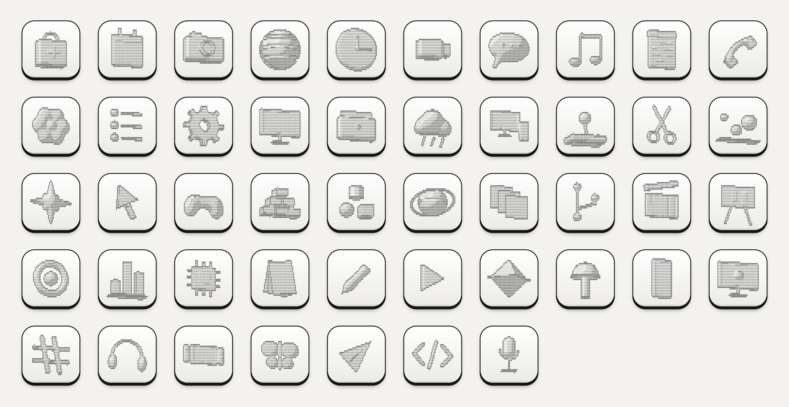

# ASCII 3D Icons

App icons made from real 3D models, rendered in shaded ASCII characters on raised keycap tiles. For macOS, iPhone and your design tools.

[](https://github.com/leobyday/ascii-icons/actions/workflows/ci.yml)

**New here? Start with the [walkthrough](docs/walkthrough.md)**, then read the [design guide](docs/design-guide.md) for how to use the set well.



## Every icon is a 3D model

Each icon is a small 3D model of a generic object, lit from the upper left and drawn with nine characters, from light to shadow:

```
.  :  -  =  +  *  #  %  @
```

The outlines are traced with `@`, so the shapes stay readable even at icon size.



Because they're real models, they can turn:



<table>
<tr>
<td width="50%" valign="top">

### Built from noise

Every icon can resolve out of random characters, the way an image model generates a picture.



</td>
<td width="50%" valign="top">

### A whole home screen

Icons, widgets, folders and wallpaper, all in the same style.



</td>
</tr>
</table>

### The full set



## What's inside

| Folder | Contents |
| --- | --- |
| `icons/` | 16 iPhone and 33 Mac icons (1024 px PNG), an SVG of every model, and wallpapers |
| `install/` | The Mac installer and uninstaller, and the iPhone setup guide |
| `skills/` | Claude skills for making new icons, in code or in Figma, Paper and pen.dev |
| `src/` | The renderer, the 3D model library and the SVG/HTML exporter |
| `docs/` | The [walkthrough](docs/walkthrough.md), the [design guide](docs/design-guide.md), a live demo and the README media |
| `scripts/` | The build that renders the PNGs, SVGs and wallpapers |
| `test/` | Tests for the renderer and exporter |

## Install on a Mac

```sh
curl -fsSL https://raw.githubusercontent.com/leobyday/ascii-icons/main/install/macos/install.sh | bash
```

Or from a clone:

```sh
git clone https://github.com/leobyday/ascii-icons.git
cd ascii-icons
install/macos/install.sh --dry-run   # see what would change
install/macos/install.sh
```

The installer changes the icon of every app in `install/macos/apps.tsv` that you have installed, sets the wallpaper (skip it with `--icons-only`), then restarts the Dock and Finder.

- App Store apps such as Keynote ask for your admin password once.
- If an app still won't change, allow Terminal in **System Settings → Privacy & Security → App Management** and run it again.
- Apple's built-in apps (Safari, Mail, Finder…) are protected by macOS and can't be re-iconed.
- App updates sometimes restore the original icon; run the installer again.

To undo everything: `install/macos/uninstall.sh`.

## Install on iPhone

iOS doesn't allow icon themes, so each icon is added as a Shortcut that opens the app. See [install/ios/README.md](install/ios/README.md).

## Make your own icons

You need Node 18+. For the PNGs you also need Python 3 with Pillow (`pip3 install pillow`).

```sh
node src/cli.js                              # list the models
node src/cli.js gear --angle 0.5             # preview one in the terminal
node src/cli.js gear --format svg > gear.svg # a finished icon as SVG
node src/cli.js gear --format html           # a keycap tile as HTML
```

To add an app:

1. Pick a model from the list, or write a new one in `src/models.js`. The [walkthrough](docs/walkthrough.md#6-make-new-icons-by-hand) shows an example.
2. Add a line to `install/macos/apps.tsv` or `install/ios/icons.tsv`: the app name, a tab, then the model name.
3. Run `python3 scripts/build.py`, then `npm test`.

Open `docs/demo/index.html` in a browser to see every model rotating.

### Use the renderer in your own project

```js
const ASCII3D = require("./src/ascii3d");
const { toSVG } = require("./src/export");
require("./src/models");

const art = ASCII3D.render("headphones", { cols: 60, rows: 36, angle: 0.4 });
console.log(art);          // text
console.log(toSVG(art));   // keycap icon
```

In a browser, load `src/ascii3d.js`, `src/models.js` and `src/export.js` with `<script>` tags and use `window.ASCII3D` and `window.ASCII3DExport`.

## Use with Claude

The `skills/` folder has four skills:

| Skill | What it does |
| --- | --- |
| [`ascii-3d-icons`](skills/ascii-3d-icons/SKILL.md) | Models new objects, builds icons, installs them on Mac or iPhone |
| [`ascii-icons-figma`](skills/ascii-icons-figma/SKILL.md) | Creates icons in Figma as editable components |
| [`ascii-icons-paper`](skills/ascii-icons-paper/SKILL.md) | Creates icons in Paper as live HTML |
| [`ascii-icons-pen`](skills/ascii-icons-pen/SKILL.md) | Creates icons in pen.dev documents |

Copy the ones you want into your skills folder (for Claude Code: `~/.claude/skills/`), connect your design tool's MCP server, and ask, for example: *"Make an ASCII 3D icon for Notion in my Figma file."*

## Contributing

New models and app mappings are welcome. See [CONTRIBUTING.md](CONTRIBUTING.md).

## License

Code and icons: [MIT](LICENSE). The bundled JetBrains Mono font is under the [SIL Open Font License](scripts/fonts/OFL.txt).

App names are used only to say which icon goes with which app. The icons are generic objects and don't reproduce any company's logo.

The Notes icon in the animations is Apple's ([Wikimedia Commons](https://commons.wikimedia.org/wiki/File:Apple_Notes_icon.svg)); Notes is a trademark of Apple Inc. It isn't included in this repository.
