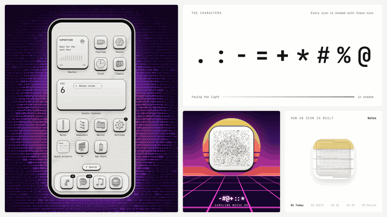
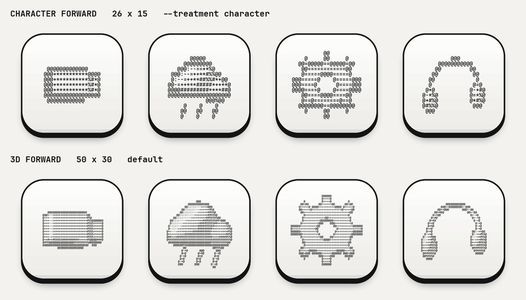

# ASCII 3D Icons

App icons drawn as 3D models in shaded ASCII characters, free to download, and a Claude skill to make more in the same style.

[](https://github.com/leobyday/ascii-icons/actions/workflows/ci.yml)



## Get the icons

**[Download all icons (ZIP)](https://github.com/leobyday/ascii-icons/releases/latest/download/ascii-3d-icons.zip)**: an SVG of every model, iPhone and Mac PNGs, and wallpapers.

Every icon is listed with what it depicts in the [catalog](icons/README.md). Or take just what you need:

Every icon comes in two treatments: the same 3D model on a fine or a coarse grid of characters.



| Treatment | Grid | Looks like |
| --- | --- | --- |
| **3D forward** ([`icons/3d/`](icons/3d)) | 50 × 30 characters | The shading reads as a solid object. The default, and the one to use as app icons: it stays clear at Dock size. |
| **Character forward** ([`icons/character/`](icons/character)) | 26 × 15 characters | Bigger characters you read as type. A stylized look for sizes of about 120 px and up. |

| Folder (in each treatment) | What's in it |
| --- | --- |
| `svg/` | Every icon (about 50) as an SVG keycap tile. The characters stay editable text in Figma, Paper, pen.dev or a browser. |
| `ios/` | iPhone app icons, 1024 px PNG |
| `macos/` | Mac app icons, 1024 px PNG |
| [`icons/wallpapers/`](icons/wallpapers) | Matching wallpapers for Mac and iPhone |

Open any file on GitHub and click **Download raw file** to save it. Icons are MIT licensed, so use them in anything.

## Make new ones with the skill

Need an icon that isn't in the set, or one at a different angle, size or with motion? The skill teaches Claude the whole style, so it can make new icons that match.

1. **Install the skill:** copy [`skills/ascii-3d-icons`](skills/ascii-3d-icons/SKILL.md) into your skills folder (Claude Code: `~/.claude/skills/`; in the Claude app, upload it as a skill). Designing in Figma, Paper or pen.dev? Add `ascii-icons-figma`, `-paper` or `-pen` too.
2. **Ask for what you want.** Every icon is defined by the same short [spec](skills/ascii-3d-icons/SKILL.md#the-icon-spec): a subject and the parts it reads as. The style and motion are fixed, so new icons match the set.

   > Make an ASCII 3D icon. Subject: a coffee cup. Reads as: a cylinder cup and a ring handle.

   > Make an ASCII 3D icon of a coffee cup.

   > Turn this flat icon (attached) into an ASCII 3D icon and animate it spinning.

   > Make a matching set of five icons for my app's onboarding: camera, map, chat, wallet, settings.

   > Give me the headphones icon as a 512 px PNG and as SVG.

   > Build these as components in my Figma file "Icons".

3. Claude reuses an icon from the set when one fits. Otherwise it models the new object in 3D, checks it from every side, and gives you PNG, SVG, HTML or an animation, or places it straight into your design file.

No Claude? The skill only uses plain code you can run yourself; see [Make icons by hand](#make-icons-by-hand) and the [walkthrough](docs/walkthrough.md). The [design guide](docs/design-guide.md) covers how to use the style well.

## Every icon is a 3D model

Each icon is a small 3D model of a generic object, lit from the upper left and drawn with nine characters, from light to shadow:

```
.  :  -  =  +  *  #  %  @
```

The outlines are traced with `@`, so the shapes stay readable even at icon size.


Because they're real models, they can turn:


<table>
<tr>
<td width="50%" valign="top">

### Built from noise

Every icon can resolve out of random characters, the way an image model generates a picture.


</td>
<td width="50%" valign="top">

### Works as a full theme

As one example, the repo includes a complete phone and Mac theme made with it.


</td>
</tr>
</table>

### The example set


## What's inside

| Folder | Contents |
| --- | --- |
| `icons/` | The icons: SVG for every model, iPhone and Mac PNGs, wallpapers |
| `install/` | Which icon goes with which app (`ios/icons.tsv`, `macos/apps.tsv`) and the iPhone setup guide |
| `skills/` | Claude skills for making new icons, in code or in Figma, Paper and pen.dev |
| `src/` | The renderer, the 3D model library and its catalog of specs, motion helpers, the SVG/HTML exporter and the CLI. No dependencies. |
| `types/` | TypeScript declarations for everything in `src/` |
| `docs/` | The [walkthrough](docs/walkthrough.md), the [design guide](docs/design-guide.md), a live demo and the README media |
| `scripts/` | The build (PNGs, SVGs, wallpapers, catalog), `flatten.py` for turning flat icons into ASCII, and `animate.py` for MP4 and GIF |
| `test/` | Tests for the renderer, exporter, motion helpers and CLI |

## Make icons by hand

You need Node 18+. For the PNGs you also need Python 3 with Pillow (`pip3 install pillow`).

```sh
node src/cli.js                              # list the models
node src/cli.js gear --angle 0.5             # preview one in the terminal
node src/cli.js gear --format svg > gear.svg # a finished icon as SVG
node src/cli.js gear --treatment character  # bigger characters (default: 3d)
node src/cli.js gear --format html           # a keycap tile as HTML
```

To add an app:

1. Pick a model from the list, or write a new one in `src/models.js`. The [walkthrough](docs/walkthrough.md#5-make-new-icons-by-hand) shows an example.
2. Add a line to `install/macos/apps.tsv` or `install/ios/icons.tsv`: the app name, a tab, then the model name.
3. Run `python3 scripts/build.py`, then `npm test`.

Open `docs/demo/index.html` in a browser to browse every model and watch any of them turn.

### Use the renderer in your own project

```js
const ASCII3D = require("./src/ascii3d");
const { toSVG } = require("./src/export");
require("./src/models");

const art = ASCII3D.render("headphones", { cols: 60, rows: 36, angle: 0.4 });
console.log(art);          // text
console.log(toSVG(art));   // keycap icon
```

In a browser, load `src/ascii3d.js`, `src/models.js`, `src/export.js` and `src/motion.js` with `<script>` tags and use `window.ASCII3D`, `window.ASCII3DExport` and `window.ASCII3DMotion`. Exported SVGs can sit inline on the same page: element ids are namespaced per icon, and every tile is labeled for screen readers (pass `title`).

### Turn a flat icon into 3D, then animate it

```sh
python3 scripts/flatten.py icon.png   # the flat icon as ASCII, to see which parts carry the shape
```

Model those parts in `src/models.js`, then animate. `python3 scripts/animate.py <model>` writes an MP4 or GIF with the house motion, `--motion generate` resolves it out of noise, and `--motion build --source icon.png` makes the five-step build-up shown above. The motions live in `src/motion.js`: `turn` (the house motion: continuous turns on the icon's own axis), a single `spin`, a gentle `sway` and `reveal` (resolving out of noise), all built to loop without a seam. The [skill](skills/ascii-3d-icons/SKILL.md) walks through the whole process with a worked example.

## The skills

The `skills/` folder has four skills:

| Skill | What it does |
| --- | --- |
| [`ascii-3d-icons`](skills/ascii-3d-icons/SKILL.md) | Models new objects and builds, exports and animates icons |
| [`ascii-icons-figma`](skills/ascii-icons-figma/SKILL.md) | Creates icons in Figma as editable components |
| [`ascii-icons-paper`](skills/ascii-icons-paper/SKILL.md) | Creates icons in Paper as live HTML |
| [`ascii-icons-pen`](skills/ascii-icons-pen/SKILL.md) | Creates icons in pen.dev documents |

Copy the ones you want into your skills folder (for Claude Code: `~/.claude/skills/`), connect your design tool's MCP server, and ask, for example: *"Make an ASCII 3D icon for Notion in my Figma file."*

## Use them as app icons on iPhone

iOS doesn't allow icon themes, so each icon is added as a Shortcut that opens the app. See [install/ios/README.md](install/ios/README.md).

## Contributing

New models and app mappings are welcome. See [CONTRIBUTING.md](CONTRIBUTING.md).

## License

Code and icons: [MIT](LICENSE). The bundled JetBrains Mono font is under the [SIL Open Font License](scripts/fonts/OFL.txt).

App names are used only to say which icon goes with which app. The shared icons are generic objects rather than company logos, because logos are trademarks of their owners. For your own brand, the skill can model your mark the same way.

The Notes icon in the animations is Apple's ([Wikimedia Commons](https://commons.wikimedia.org/wiki/File:Apple_Notes_icon.svg)); Notes is a trademark of Apple Inc. It isn't included in this repository.
