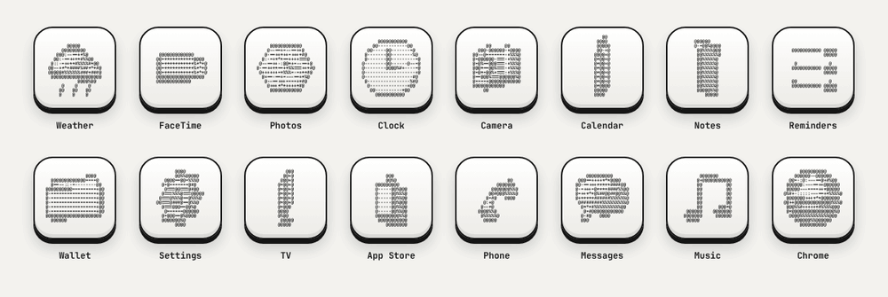

# Walkthrough

A tour of ASCII 3D Icons, from trying the icons to making new ones in your design tool. Each part stands on its own; skip to what you need. For how to use the set well in a product, see the [design guide](design-guide.md).

1. [What you get](#1-what-you-get)
2. [Use them on your iPhone](#2-use-them-on-your-iphone)
3. [Use the icons in a design](#3-use-the-icons-in-a-design)
4. [Make new icons with Claude](#4-make-new-icons-with-claude)
5. [Make new icons by hand](#5-make-new-icons-by-hand)
6. [How it works](#6-how-it-works)

---

## 1. What you get



| Path | What it is |
| --- | --- |
| `icons/3d/` | The 3D-forward treatment (50 × 30 characters): `svg/` every model, `ios/` 16 iPhone icons, `macos/` 33 Mac icons |
| `icons/character/` | The same in the character-forward treatment (26 × 15 bigger characters) |
| `icons/wallpapers/` | Mac (3456 × 2234) and iPhone (1179 × 2556) wallpapers |
| `skills/` | Four Claude skills: the icon maker, plus Figma, Paper and pen.dev |
| `docs/demo/index.html` | Every model, live, turning on its axis in your browser |

Get everything with:

```sh
git clone https://github.com/leobyday/ascii-icons.git
cd ascii-icons
```

Or use **Code → Download ZIP** on GitHub.

## 2. Use them on your iPhone

iOS doesn't allow icon themes, so each icon becomes a Shortcut that opens its app. About a minute per app; full steps in [install/ios/README.md](../install/ios/README.md). In short:

1. Save `icons/3d/ios/*.png` (or `icons/character/ios/`) and `icons/wallpapers/ios.png` to Photos.
2. Shortcuts → **+** → **Open App** → pick the app.
3. Shortcut name → **Add to Home Screen** → icon → **Choose Photo**.
4. Remove the original icon from the Home Screen (it stays in the App Library).

Shortcut icons don't show badges, and nothing on iOS can animate an icon.

## 3. Use the icons in a design

Every model is in `icons/3d/svg/` and `icons/character/svg/` as a 1024 px keycap icon. The characters are real text in JetBrains Mono, so they stay editable.

- **Figma:** drag the SVGs onto the canvas, or let Claude build them as components (section 4).
- **Paper:** paste the HTML from `node src/cli.js <model> --format html`, or import the SVG.
- **pen.dev:** paste the SVG's contents onto the canvas.
- **A web page:** `node src/cli.js <model> --format html --size 120` gives a self-contained tile. For live, turning icons, load `src/ascii3d.js` and `src/models.js` and call `ASCII3D.render()`; `docs/demo/index.html` shows how.

Install JetBrains Mono (free from Google Fonts) so the characters keep their look.

## 4. Make new icons with Claude

The `skills/` folder teaches Claude the whole process.

| Skill | Use it to |
| --- | --- |
| `ascii-3d-icons` | Model new objects, render, export and animate icons |
| `ascii-icons-figma` | Put icons into a Figma file as editable components |
| `ascii-icons-paper` | Put icons into a Paper file as live HTML |
| `ascii-icons-pen` | Put icons into a pen.dev document |

**Install the skills.** Copy the folders you want into your skills folder: for Claude Code that's `~/.claude/skills/`. In the Claude app, upload them as skills.

**Connect the design tool.** The Figma, Paper and pen.dev skills work through each tool's MCP server, so connect the one you use first. For pen.dev, also turn on Settings → MCP in the app.

**Ask.** For example:

> Make an ASCII 3D icon for my Notion app and add it to my Figma file "Icons".

> Create a coffee cup icon in the ASCII 3D style in Paper, then a matching tea cup.

> Make Linear and Arc icons in the character-forward treatment as 512 px PNGs.

Claude picks or models an object (for other companies' apps, an object rather than their trademarked logo), previews it in the terminal until it reads clearly, then builds it into your file or exports it.

## 5. Make new icons by hand

You need Node 18+. PNG builds also need Python 3 with Pillow (`pip3 install pillow`).

```sh
node src/cli.js                       # list models
node src/cli.js coffee-cup            # preview (after you add it)
node src/cli.js coffee-cup --angle 0.5
```

1. **Model it.** Starting from a flat icon? Run `python3 scripts/flatten.py icon.png` first to see which parts carry the shape; the [skill](../skills/ascii-3d-icons/SKILL.md#2-from-a-2d-asset-to-a-3d-model) explains how to turn them into depth. Add an entry to `models` in `src/models.js`. A coffee cup, for example, is a cylinder with a ring for a handle:

   ```js
   "coffee-cup": (x, y, z) =>
     union(
       subtract(cylinderY(x + 0.15, y + 0.05, z, 0.5, 0.55), cylinderY(x + 0.15, y - 0.1, z, 0.42, 0.5)),
       torusZ(x - 0.45, y + 0.05, z, 0.22, 0.07),
     ),
   ```

   x is right, y is up, and the viewer looks along +z, so details in front of a surface use `z + d`. Parts thinner than about 0.05 disappear at icon size.

2. **Preview** at the default angle and at `--angle 0.5` until it reads at a glance.
3. **Map it to an app** in `install/macos/apps.tsv` or `install/ios/icons.tsv`: the app name, a tab, the model name.
4. **Build** with `python3 scripts/build.py` (PNGs, SVGs and wallpapers), or `--only "App Name"` for one PNG.
5. **Animate** (optional) with `python3 scripts/animate.py coffee-cup`: an MP4 of it turning on its axis. Add `--motion generate` to show it forming, or `--out coffee-cup.gif` for a GIF.
6. **Test** with `npm test`.

## 6. How it works

Each icon is a signed distance function: given a point in space, it returns how far that point is from the object's surface. For every character cell the renderer shoots a ray into the scene and steps forward by that distance until it reaches the surface. It then works out which way the surface faces and how much light from the upper left it catches. That brightness picks a character:

```
lit  .  :  -  =  +  *  #  %  @  shadow
```

A final pass compares the depth of neighboring cells. Where it jumps (an object's silhouette, or a part sitting in front of another) the cell becomes `@`, which is what keeps small icons crisp. Turning the model is just rotating the ray, so every icon can turn on its own axis or be drawn from any angle.

The code is in `src/ascii3d.js` (about 250 lines, no dependencies).
